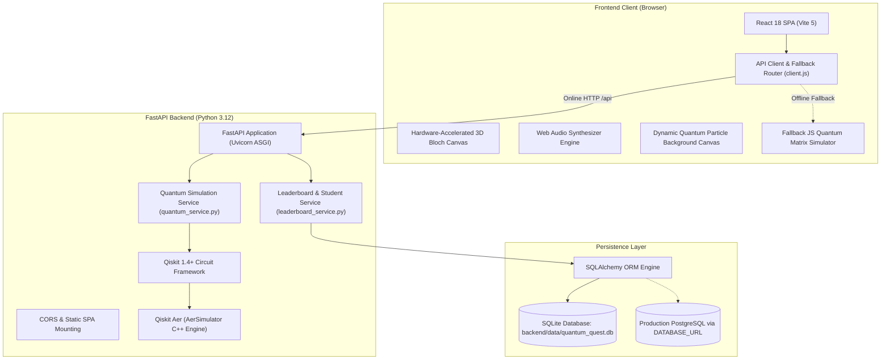
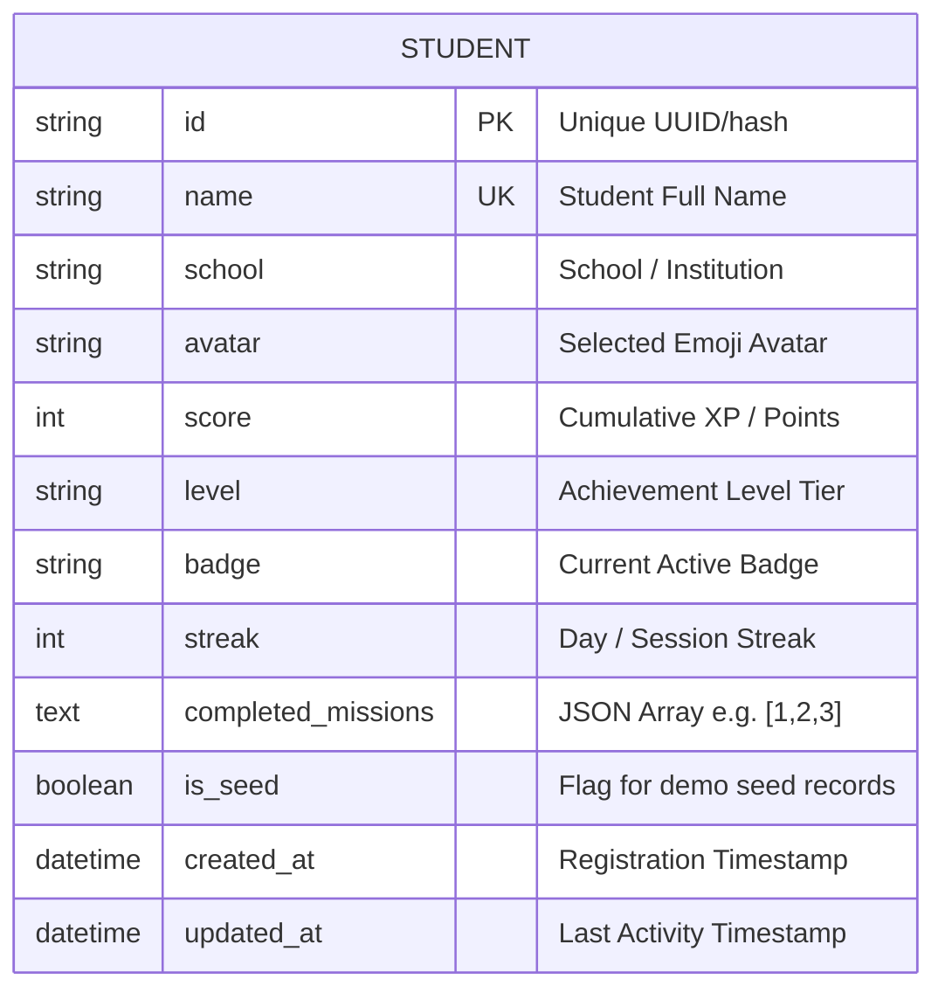

# Quantum Quest: The Quantum Circuit Adventure ⚛️
## Complete Technical Architecture, Mathematical Foundations & Operational Documentation

> **Event:** QExpo 2026 Hackathon  
> **Track:** Quantum Education & Outreach  
> **Problem Statement:** *Quantum Circuits: Single-Qubit Gates and Operations, Multi-Qubit Gates and Operations, and Design and Simulation of Quantum Circuits.*  
> **Stack:** React 18, Vite 5, Tailwind CSS, Three.js / Canvas 3D, Web Audio API, Python 3.12, FastAPI, Qiskit 1.4+, Qiskit Aer (`AerSimulator`), SQLAlchemy, SQLite / PostgreSQL, Docker.

---

## 📑 Table of Contents
1. [Executive Summary & Problem Statement](#1-executive-summary--problem-statement)
2. [High-Level System Architecture](#2-high-level-system-architecture)
3. [Repository Structure & Codebase Tour](#3-repository-structure--codebase-tour)
4. [Frontend Architecture & Interactive Modules](#4-frontend-architecture--interactive-modules)
5. [Backend Architecture & Quantum Engine](#5-backend-architecture--quantum-engine)
6. [Database Schema & Multi-Student Persistence](#6-database-schema--multi-student-persistence)
7. [Comprehensive REST API Reference](#7-comprehensive-rest-api-reference)
8. [Quantum Physics & Mathematical Formulations](#8-quantum-physics--mathematical-formulations)
9. [Testing, Benchmarking & Verification](#9-testing-benchmarking--verification)
10. [Local Development & Setup Guide](#10-local-development--setup-guide)
11. [Production Deployment Guide (Render, Netlify, Docker)](#11-production-deployment-guide)
12. [QExpo Operator Playbook & Expo FAQ](#12-qexpo-operator-playbook--expo-faq)

---

## 1. Executive Summary & Problem Statement

### The Problem
Quantum computing is fundamentally counter-intuitive. Concepts like complex statevectors, non-local entanglement, unitary transformations, phase kickback, and wave-function collapse under measurement are traditionally gated behind heavy linear algebra textbooks or abstract command-line scripts. Students, developers, and conference attendees frequently struggle to bridge the gap between mathematical notation ($|\psi\rangle = \alpha|0\rangle + \beta|1\rangle$) and physical circuit architecture.

### The Solution: Quantum Quest
**Quantum Quest: The Quantum Circuit Adventure** is a production-grade, gamified quantum computing playground and educational learning platform. It transforms quantum concepts into an interactive, visual, and cinematic experience:
- **Real Quantum Simulation:** Every circuit simulation, statevector calculation, Bell-state correlation, and measurement histogram is computed on the backend using **Qiskit 1.4+ and Qiskit Aer (`AerSimulator`)** via high-performance C++ simulation kernels.
- **Fail-Safe Offline Resilience:** If internet connectivity drops at an expo booth, the frontend automatically falls back to an embedded pure-mathematics JavaScript quantum matrix engine (`quantumEngine.js`).
- **Multi-Student Expo Workflow:** Booth attendees can register their name and school, choose an avatar, complete missions, earn verifiable badges and XP, and compete on a live, persistent leaderboard stored in a real database.

---

## 2. High-Level System Architecture

Quantum Quest is built on a decoupled, micro-service-ready architecture combining a modern client-side Single Page Application (SPA) with a high-performance Python ASGI backend.



### Architectural Highlights
1. **Dual-Mode Quantum Simulation:** The application checks backend health upon launch. When online, state preparation, Bell-state correlation, and arbitrary 1–5 wire circuits run via Qiskit Aer on Python. If the backend is unreachable, the client-side matrix engine transparently handles 1–3 qubit linear algebra calculations without crashing or interrupting the user.
2. **Dual-Mode Database Persistence:** Zero-configuration local development uses embedded SQLite (`backend/data/quantum_quest.db`). For cloud platforms (Render, Railway, Supabase, Neon), providing `DATABASE_URL` seamlessly switches SQLAlchemy to PostgreSQL connection pooling.
3. **Single-Container Production Distribution:** The multi-stage `Dockerfile` compiles the React frontend to optimized static assets, which FastAPI directly serves at the root path `/` alongside the `/api` endpoints, allowing zero-maintenance single-port deployment.

---

## 3. Repository Structure & Codebase Tour

```
quantum-playground/
├── backend/                              # Python FastAPI + Qiskit backend
│   ├── app/
│   │   ├── __init__.py
│   │   ├── main.py                       # FastAPI entry point, CORS, routes & SPA static mount
│   │   ├── database.py                   # SQLAlchemy engine, session maker & Base
│   │   ├── models.py                     # SQLAlchemy models (Student, LeaderboardEntry)
│   │   ├── schemas.py                    # Pydantic v2 validation models & request/response schemas
│   │   ├── quantum_service.py            # Qiskit circuit building & AerSimulator execution
│   │   └── leaderboard_service.py        # Student profile CRUD, score upsert & CSV export
│   ├── data/                             # Persistent storage directory (SQLite DB)
│   ├── tests/                            # Pytest test suite (40 tests)
│   │   ├── test_qubit.py                 # Single qubit preparation & measurement tests
│   │   ├── test_gates.py                 # Single-qubit & rotation gate unitary tests
│   │   ├── test_multi_qubit.py           # Multi-qubit circuit simulation tests
│   │   ├── test_bell_states.py           # Bell-state correlation & basis measurement tests
│   │   ├── test_integration.py           # End-to-end API integration & health tests
│   │   └── test_leaderboard.py           # Database persistence, clear, reset & export tests
│   └── requirements.txt                  # Python dependencies (FastAPI, Qiskit, Qiskit-Aer, SQLAlchemy)
│
├── frontend/                             # React 18 + Vite frontend
│   ├── src/
│   │   ├── api/
│   │   │   └── client.js                 # Unified API client with automatic client fallback & VITE_API_URL
│   │   ├── components/
│   │   │   ├── QuantumBackground.jsx     # Cinematic interactive particle & wavefunction canvas
│   │   │   ├── BlochSphere.jsx           # 3D Canvas Bloch sphere with orbit & slerp arc animation
│   │   │   ├── QubitExplorer.jsx         # Level 1: Superposition & measurement explorer
│   │   │   ├── GateLab.jsx               # Level 2: 13-gate interactive quantum encyclopedia
│   │   │   ├── MultiQubitMissions.jsx    # Level 4: Tensor products & controlled gate missions
│   │   │   ├── BellStatesExplorer.jsx    # Level 5: Bell pairs & No-Signaling theorem
│   │   │   ├── CircuitSimulator.jsx      # Level 6: Drag-and-drop circuit builder & playhead
│   │   │   ├── StudentSessionModal.jsx   # Multi-student expo registration & profile switcher
│   │   │   ├── ChallengesLeaderboard.jsx # Live leaderboard, daily sprint & admin controls
│   │   │   ├── QuantumCertificate.jsx    # Verifiable printable QExpo 2026 completion certificate
│   │   │   └── PresentationMode.jsx      # 7-step guided judge tour for evaluation
│   │   ├── utils/
│   │   │   ├── quantumEngine.js          # Client-side pure-mathematics matrix quantum simulator
│   │   │   ├── audio.js                  # Web Audio synthesizer for procedural sci-fi audio effects
│   │   │   └── exportUtils.js            # OpenQASM and JSON circuit diagram exporter
│   │   ├── App.jsx                       # Root application container, navigation tabs & state sync
│   │   ├── main.jsx                      # React 18 DOM mount point
│   │   └── index.css                     # Design tokens, typography & CSS animations
│   ├── package.json                      # Frontend dependencies (React, Lucide, Recharts)
│   └── vite.config.js                    # Vite bundler configuration & local dev proxy
│
├── Dockerfile                            # Multi-stage production container (Node + Python)
├── docker-compose.yml                    # Local/VPS deployment with persistent DB volume
├── netlify.toml                          # Netlify build configuration & SPA redirects
├── DEPLOYMENT_GUIDE.md                   # Step-by-step production hosting manual
├── DOCUMENTATION.md                      # Complete technical & physics documentation (this file)
├── README.md                             # Repository overview and quick start guide
├── pytest.ini                            # Pytest configuration with test paths & pythonpath
└── verify_simulation.py                  # Standalone 7-point physics verification script
```

---

## 4. Frontend Architecture & Interactive Modules

### 4.1. Cinematic Dynamic Quantum Background (`QuantumBackground.jsx`)
The home view features a custom HTML5 Canvas animation engine simulating quantum phenomena:
- **Quantum Nodes & Entanglement Graph:** 45 floating particle nodes representing quantum state vectors. When two nodes drift within 120 pixels of each other, dynamic wave lines draw between them, visualizing quantum entanglement.
- **Interfering Wavefunctions:** Multiple sine wave packets ($\sin(kx - \omega t)$) ripple across the background with phase shifts, simulating quantum wave interference.
- **Bloch Sphere Wireframe Projection:** A rotating wireframe sphere with equatorial rings and pole markers floats dynamically in the upper right.
- **Cursor Gravitational Entanglement:** Moving the mouse exerts a quantum potential field, drawing nearby particles into localized orbital superpositions.

### 4.2. 3D Bloch Sphere Engine (`BlochSphere.jsx`)
A hardware-accelerated 3D projection on HTML5 Canvas:
- **Spherical Coordinate Mapping:** Maps any single-qubit state $|\psi\rangle = \cos(\theta/2)|0\rangle + e^{i\phi}\sin(\theta/2)|1\rangle$ to Cartesian coordinates $[x, y, z] = [\sin\theta\cos\phi, \sin\theta\sin\phi, \cos\theta]$.
- **Smooth Arc Slerp Animation:** When a quantum gate is applied, the vector animates smoothly along the true geodesic spherical arc rather than taking a linear Cartesian shortcut through the interior of the sphere.
- **Interactive Orbit:** Drag-to-rotate around yaw and pitch axes with momentum damping, plus an auto-orbit toggle.
- **Phase Science Explanation:** Deep-dive modal clarifying why global phase $e^{i\gamma}|\psi\rangle$ is unobservable, whereas relative phase $e^{i\phi}$ dictates interference on the equator.

### 4.3. Interactive Gate Academy (13 Gates) (`GateLab.jsx`)
An interactive quantum gate test bench covering:
- **Pauli Gates:** $X$ (NOT bit-flip), $Y$ (bit-flip + phase shift), $Z$ (phase-flip).
- **Superposition & Phase Gates:** Hadamard ($H$), Phase ($S = \sqrt{Z}$), $\pi/8$ Phase ($T = Z^{1/4}$), Identity ($I$).
- **Continuous Rotation Gates:** $R_X(\theta)$, $R_Y(\theta)$, $R_Z(\theta)$ with dynamic angle sliders from $0$ to $2\pi$.
- **Multi-Qubit Gates:** Controlled-NOT ($CNOT$), Controlled-Z ($CZ$), and $SWAP$.
- *Each gate card displays:* Exact unitary matrix $U$, algebraic commutation rules, Bloch sphere geometric rotation vector, basis transformation table, and an instant execution trigger.

### 4.4. Bell States & Entanglement Explorer (`BellStatesExplorer.jsx`)
Interactive laboratory exploring the four maximally entangled two-qubit Bell states (EPR pairs):
- $|\Phi^+\rangle = \frac{1}{\sqrt{2}}(|00\rangle + |11\rangle)$
- $|\Phi^-\rangle = \frac{1}{\sqrt{2}}(|00\rangle - |11\rangle)$
- $|\Psi^+\rangle = \frac{1}{\sqrt{2}}(|01\rangle + |10\rangle)$
- $|\Psi^-\rangle = \frac{1}{\sqrt{2}}(|01\rangle - |10\rangle)$

**Key Scientific Features:**
- Dual-basis measurement: Measure on Qiskit Aer in the computational $Z$-basis or the Hadamard-rotated $X$-basis to verify true quantum non-locality.
- Visual entanglement bridge between Qubit A and Qubit B.
- **No-Signaling Theorem Demonstration:** Explains why measuring Qubit A yields a 50/50 random outcome that cannot transmit classical information faster than light, despite instantaneous wavefunction collapse.

### 4.5. Multi-Qubit Circuit Builder (`CircuitSimulator.jsx`)
Visual drag-and-drop circuit designer:
- 1 to 4 configurable qubit wires ($q_0, q_1, q_2, q_3$).
- Wire initial state toggles ($|0\rangle$ or $|1\rangle$).
- Gate placement palette for all 13 gates with multi-qubit target/control wiring.
- Step-by-step playhead (Step Forward, Step Backward, Run All).
- Real-time complex statevector amplitude table: shows magnitude, phase angle in degrees, and probability $|c_i|^2$.
- Finite-shot measurement histogram on Qiskit Aer (100, 1024, or 4096 shots).
- Built-in algorithm library: Bell state, GHZ 3-qubit entangled state, Quantum Teleportation protocol, Double NOT, and Phase Kickback.
- Export to OpenQASM 2.0 and ASCII text circuit diagram.

### 4.6. Multi-Student Session Registration (`StudentSessionModal.jsx`)
Built specifically for hackathons and science expos:
- Students register with their **Name**, **School/College**, and select a **Quantum Avatar** (⚛️, 🚀, 🔬, ⚡, 🌌, 🧠, 🐱).
- Switching students takes two clicks. Each student's XP, unlocked missions, and achievements are saved to the persistent database.
- Shows current rank, badges, and progress overview.

---

## 5. Backend Architecture & Quantum Engine

The backend is built with **FastAPI** and **Qiskit 1.4+** with **Qiskit Aer** (`AerSimulator`).

### 5.1. Quantum Simulation Service (`quantum_service.py`)
- **Circuit Construction:** Constructs native `qiskit.QuantumCircuit` objects dynamically from client JSON payloads.
- **Statevector Computation:** Uses Qiskit's `Statevector.from_instruction(qc)` to extract the exact, normalized complex amplitude vector $\sum c_i |i\rangle$.
- **Finite-Shot Stochastic Measurement:** Appends `qc.measure_all()` and executes on `AerSimulator(method='statevector')` across configurable shot counts ($100$ to $10,000$).
- **Qiskit Little-Endian Conversion:** Qiskit orders qubits in little-endian format ($q_n \dots q_1 q_0$). The backend formats basis labels ($|00\rangle, |01\rangle, \dots$) consistently and provides explicit explanatory notes in API responses so students understand qubit ordering.

### 5.2. Quantum Teleportation Pipeline (`simulate_teleportation`)
Simulates the full 3-qubit teleportation protocol:
1. Prepares arbitrary input state on Qubit 0 ($|\psi\rangle = \alpha|0\rangle + \beta|1\rangle$).
2. Entangles Qubit 1 and Qubit 2 into a Bell pair $|\Phi^+\rangle$.
3. Alice applies $CNOT(q_0 \to q_1)$ and $H(q_0)$.
4. Alice measures $q_0$ and $q_1$ into classical bits $c_0, c_1$.
5. Bob applies conditional Pauli corrections ($X^{c_1} Z^{c_0}$) to recover $|\psi\rangle$ on Qubit 2.

---

## 6. Database Schema & Multi-Student Persistence

The persistence layer uses **SQLAlchemy 2.0 ORM** with automatic table creation upon server startup (`Base.metadata.create_all(bind=engine)`).

### 6.1. Entity Relationship Diagram



### 6.2. Table: `students`
| Column | Type | Constraints | Description |
|---|---|---|---|
| `id` | `VARCHAR(64)` | PRIMARY KEY, INDEX | Unique identifier derived from student name or UUID |
| `name` | `VARCHAR(128)` | UNIQUE, NOT NULL, INDEX | Student's display name |
| `school` | `VARCHAR(128)` | DEFAULT 'Student Visitor' | School, college, or organization name |
| `avatar` | `VARCHAR(16)` | DEFAULT '⚛️' | Selected profile avatar emoji |
| `score` | `INTEGER` | DEFAULT 0, INDEX | Total cumulative XP or timed sprint score |
| `level` | `VARCHAR(64)` | DEFAULT 'Qubit Novice' | Achievement tier title |
| `badge` | `VARCHAR(64)` | DEFAULT 'Active Hacker' | Unlocked badge name |
| `streak` | `INTEGER` | DEFAULT 1 | Session or daily challenge streak |
| `completed_missions` | `TEXT` | DEFAULT '[1]' | JSON-serialized array of completed level IDs |
| `is_seed` | `BOOLEAN` | DEFAULT FALSE | Flag indicating default scientific benchmark entries |
| `created_at` | `DATETIME` | UTC Timestamp | Creation timestamp |
| `updated_at` | `DATETIME` | UTC Timestamp | Last update timestamp |

### 6.3. Database Configuration
In `backend/app/database.py`:
- If `DATABASE_URL` is set in the environment:
  - If URL starts with `postgres://`, it is automatically converted to `postgresql://` (required for SQLAlchemy 2.0).
  - Connects to PostgreSQL with connection pooling.
- Otherwise:
  - Uses local SQLite database at `sqlite:///backend/data/quantum_quest.db` with `check_same_thread=False`.

---

## 7. Comprehensive REST API Reference

All endpoints are served under `/api` and return standard JSON responses. Interactive Swagger documentation is available at `/docs`.

### 7.1. System Health
#### `GET /api/health`
Returns backend health, Qiskit version, and Qiskit Aer simulation engine status.
- **Response `200 OK`**:
```json
{
  "status": "healthy",
  "app_name": "Quantum Playground API",
  "category": "Quantum Education & Outreach",
  "expo": "QExpo 2026",
  "qiskit_version": "1.4.0",
  "aer_version": "0.16.1",
  "simulator_available": true
}
```

---

### 7.2. Quantum Simulation Endpoints

#### `POST /api/qubit/prepare`
Prepares a single qubit in one of the standard basis states ($|0\rangle, |1\rangle, |+\rangle, |-\rangle$).
- **Request Body**:
```json
{ "state": "+" }
```
- **Response `200 OK`**:
```json
{
  "experiment": "Single Qubit Preparation",
  "state_label": "|+⟩",
  "initial_state": "|0⟩",
  "gates": ["H"],
  "circuit": {
    "ascii_art": "   ┌───┐\nq: ┤ H ├\n   └───┘",
    "num_qubits": 1,
    "depth": 1,
    "gate_count": 1,
    "gate_sequence": ["H"]
  },
  "statevector": [
    { "basis": "|0⟩", "real": 0.7071, "imag": 0.0, "magnitude": 0.7071, "probability": 0.5, "phase_degrees": 0.0, "formatted": "0.7071" },
    { "basis": "|1⟩", "real": 0.7071, "imag": 0.0, "magnitude": 0.7071, "probability": 0.5, "phase_degrees": 0.0, "formatted": "0.7071" }
  ],
  "probabilities": { "0": 0.5, "1": 0.5 },
  "explanation": "Hadamard gate applied to |0⟩ creates equal superposition."
}
```

---

#### `POST /api/qubit/measure`
Performs finite-shot measurement on a single-qubit state using Qiskit Aer.
- **Request Body**:
```json
{ "state": "+", "shots": 1024 }
```
- **Response `200 OK`**:
```json
{
  "experiment": "Single Qubit Measurement",
  "counts": { "0": 519, "1": 505 },
  "frequencies": { "0": 0.5068, "1": 0.4932 },
  "shots": 1024,
  "explanation": "Wavefunction collapse under Born's rule."
}
```

---

#### `POST /api/circuit/run`
Applies an arbitrary sequence of single-qubit gates.
- **Request Body**:
```json
{
  "initial_state": "0",
  "gates": ["H", "Z", "H"],
  "shots": 500,
  "measure": true
}
```

---

#### `POST /api/bell/prepare`
Prepares one of the four canonical Bell states: `"phi_plus"`, `"phi_minus"`, `"psi_plus"`, `"psi_minus"`.
- **Request Body**:
```json
{ "state": "phi_plus" }
```

---

#### `POST /api/bell/measure`
Measures a Bell state in either the computational `"Z"` basis or the rotated `"X"` basis.
- **Request Body**:
```json
{ "state": "phi_plus", "shots": 1000, "basis": "Z" }
```
- **Response `200 OK`**:
```json
{
  "experiment": "Bell State Measurement",
  "counts": { "00": 498, "11": 502 },
  "frequencies": { "00": 0.498, "11": 0.502 },
  "shots": 1000,
  "explanation": "Perfect correlation: outcomes |01⟩ and |10⟩ have zero probability."
}
```

---

#### `POST /api/circuit/simulate`
Simulates an arbitrary multi-qubit circuit (1 to 5 wires) with single-qubit, controlled, and swap operations.
- **Request Body**:
```json
{
  "num_qubits": 2,
  "initial_states": ["0", "0"],
  "operations": [
    { "gate": "H", "target": 0 },
    { "gate": "CX", "target": 1, "control": 0 }
  ],
  "shots": 1024,
  "measure": true
}
```

---

#### `POST /api/teleport/simulate`
Executes the full 3-qubit quantum teleportation protocol.
- **Request Body**:
```json
{ "qubit_state": "+", "shots": 1024 }
```

---

### 7.3. Student Session & Database Endpoints

#### `GET /api/student/{name}`
Fetches the persistent profile, score, and unlocked missions for a student.
- **Response `200 OK`**:
```json
{
  "id": "std_f893d9",
  "name": "Kavya Sharma",
  "school": "Delhi Public School",
  "avatar": "🚀",
  "score": 850,
  "level": "Superposition Adept",
  "badge": "Phase Alchemist",
  "streak": 3,
  "completed_missions": "[1, 2, 3]",
  "completed_missions_list": [1, 2, 3],
  "timestamp": "2026-10-28T04:36:46Z",
  "rank": 2
}
```

---

#### `POST /api/student/save`
Saves or updates a student's progress and completed missions to the database.
- **Request Body**:
```json
{
  "name": "Kavya Sharma",
  "score": 1200,
  "level": "Entanglement Master",
  "badge": "Spooky Action Hero",
  "streak": 4,
  "school": "Delhi Public School",
  "avatar": "🚀",
  "completed_missions": [1, 2, 3, 4]
}
```

---

### 7.4. Leaderboard Endpoints

#### `GET /api/leaderboard`
Returns all ranked students sorted by score descending.
- **Response `200 OK`**:
```json
{
  "entries": [
    {
      "id": "std_1",
      "name": "Aarav Patel",
      "score": 1500,
      "level": "Quantum Master",
      "badge": "Circuit Architect",
      "streak": 5,
      "school": "IIT Bombay",
      "avatar": "⚛️",
      "rank": 1,
      "timestamp": "2026-10-28T04:00:00Z"
    }
  ],
  "total_players": 1,
  "timestamp": "2026-10-28T05:00:00Z"
}
```

---

#### `POST /api/leaderboard/submit`
Submits or upserts a score to the leaderboard. If the student already exists, updates score to `max(existing_score, new_score)` and recalculates ranks.
- **Request Body**:
```json
{
  "name": "Rahul Verma",
  "score": 950,
  "level": "Superposition Adept",
  "badge": "Phase Alchemist",
  "streak": 2,
  "school": "Kendriya Vidyalaya",
  "avatar": "🔬"
}
```

---

#### `POST /api/leaderboard/clear`
Wipes all entries from the database to give a fresh start for a new expo session.
- **Query Parameter:** `admin_key=qexpo2026`
- **Response `200 OK`**:
```json
{ "status": "success", "message": "Leaderboard cleared successfully", "total_players": 0 }
```

---

#### `POST /api/leaderboard/reset`
Restores the default scientific benchmark demo seeds (e.g., benchmark entries from IIT, MIT, Oxford).
- **Response `200 OK`**:
```json
{ "status": "success", "message": "Leaderboard reset to benchmark demo entries", "total_players": 5 }
```

---

#### `GET /api/leaderboard/export`
Generates and downloads a live CSV file of all student records with headers: `Rank,Name,Score,Level,Badge,Streak,School,Avatar,CompletedMissions,Timestamp`.

---

## 8. Quantum Physics & Mathematical Formulations

### 8.1. Statevector & The Born Rule
A single qubit state $|\psi\rangle \in \mathcal{H}_2$ is represented as a linear combination of orthonormal computational basis vectors:
$$|\psi\rangle = \alpha |0\rangle + \beta |1\rangle, \quad \alpha, \beta \in \mathbb{C}$$
Normalized such that:
$$\langle \psi | \psi \rangle = |\alpha|^2 + |\beta|^2 = 1$$
Under projection onto the computational basis, the probability of measuring outcome $k \in \{0, 1\}$ is given by the Born Rule:
$$P(k) = |\langle k | \psi \rangle|^2$$

### 8.2. Bloch Sphere Mapping
Every pure single-qubit state can be uniquely parameterized by polar angle $\theta \in [0, \pi]$ and azimuthal angle $\phi \in [0, 2\pi)$:
$$|\psi\rangle = \cos\left(\frac{\theta}{2}\right)|0\rangle + e^{i\phi}\sin\left(\frac{\theta}{2}\right)|1\rangle$$
The corresponding Cartesian coordinates on the unit 3D sphere $S^2$ are:
$$x = \sin\theta \cos\phi = 2\text{Re}(\alpha^*\beta)$$
$$y = \sin\theta \sin\phi = 2\text{Im}(\alpha^*\beta)$$
$$z = \cos\theta = |\alpha|^2 - |\beta|^2$$

### 8.3. Unitary Gate Matrices
All single-qubit gates are represented by $2 \times 2$ unitary operators ($U^\dagger U = I$):

$$X = \begin{pmatrix} 0 & 1 \\ 1 & 0 \end{pmatrix}, \quad Y = \begin{pmatrix} 0 & -i \\ i & 0 \end{pmatrix}, \quad Z = \begin{pmatrix} 1 & 0 \\ 0 & -1 \end{pmatrix}$$

$$H = \frac{1}{\sqrt{2}}\begin{pmatrix} 1 & 1 \\ 1 & -1 \end{pmatrix}, \quad S = \begin{pmatrix} 1 & 0 \\ 0 & i \end{pmatrix}, \quad T = \begin{pmatrix} 1 & 0 \\ 0 & e^{i\pi/4} \end{pmatrix}$$

$$R_X(\theta) = \begin{pmatrix} \cos(\theta/2) & -i\sin(\theta/2) \\ -i\sin(\theta/2) & \cos(\theta/2) \end{pmatrix}$$
$$R_Y(\theta) = \begin{pmatrix} \cos(\theta/2) & -\sin(\theta/2) \\ \sin(\theta/2) & \cos(\theta/2) \end{pmatrix}$$
$$R_Z(\theta) = \begin{pmatrix} e^{-i\theta/2} & 0 \\ 0 & e^{i\theta/2} \end{pmatrix}$$

### 8.4. Two-Qubit Entanglement & Tensor Products
Two qubits inhabit the tensor product Hilbert space $\mathcal{H}_4 = \mathcal{H}_2 \otimes \mathcal{H}_2$ with basis $\{|00\rangle, |01\rangle, |10\rangle, |11\rangle\}$.

The Controlled-NOT gate is represented by:
$$CNOT = \begin{pmatrix} 1 & 0 & 0 & 0 \\ 0 & 1 & 0 & 0 \\ 0 & 0 & 0 & 1 \\ 0 & 0 & 1 & 0 \end{pmatrix}$$

Applying $H \otimes I$ followed by $CNOT$ to $|00\rangle$ produces the canonical Bell state:
$$CNOT(H \otimes I)|00\rangle = CNOT\left(\frac{|00\rangle + |10\rangle}{\sqrt{2}}\right) = \frac{|00\rangle + |11\rangle}{\sqrt{2}} = |\Phi^+\rangle$$

### 8.5. The No-Signaling Theorem
For the entangled state $|\Phi^+\rangle$, the reduced density matrix of Qubit B after tracing out Qubit A is:
$$\rho_B = \text{Tr}_A(|\Phi^+\rangle\langle\Phi^+|) = \frac{1}{2}|0\rangle\langle 0| + \frac{1}{2}|1\rangle\langle 1| = \frac{1}{2}I$$
Regardless of whether Alice measures Qubit A in the $Z$-basis, the $X$-basis, or not at all, Bob's local state remains maximally mixed ($\rho_B = \frac{1}{2}I$). Thus, entanglement **cannot** transmit classical information faster than light, satisfying relativistic causality.

---

## 9. Testing, Benchmarking & Verification

### 9.1. Automated Pytest Test Suite (40 Tests)
Run all backend unit and integration tests:
```bash
.venv/bin/pytest backend/tests -v
```
**Test Coverage Breakdown:**
- `test_qubit.py` (8 tests): State preparation ($|0\rangle, |1\rangle, |+\rangle, |-\rangle$), normalizations, measurement shots.
- `test_gates.py` (9 tests): All 13 gates, unitary properties, phase shifts, rotation angles.
- `test_multi_qubit.py` (6 tests): Tensor products, CNOT, CZ, SWAP, circuit playhead step execution.
- `test_bell_states.py` (8 tests): All 4 Bell states, Z-basis vs X-basis measurement distributions.
- `test_integration.py` (5 tests): Health check, API error handling, CORS headers, Qiskit version validation.
- `test_leaderboard.py` (4 tests): Student profile CRUD, score upsert, `/clear`, `/reset`, and CSV export.

### 9.2. Physics Verification Script (`verify_simulation.py`)
A standalone end-to-end physics validation script that queries the live server and verifies physical principles:
```bash
python3 verify_simulation.py
```
**Verifications Performed:**
1. Health & Qiskit Aer simulation engine readiness.
2. Hadamard self-inverse identity: $H \cdot H |0\rangle = |0\rangle$.
3. Pauli-X bit flip: $X |0\rangle = |1\rangle$.
4. Bell State $|\Phi^+\rangle$ preparation: Probabilities $P(|00\rangle) = 0.5$, $P(|11\rangle) = 0.5$.
5. No-Signaling & zero cross-term verification ($P(|01\rangle) = 0, P(|10\rangle) = 0$).
6. Multi-qubit circuit simulation (3-qubit GHZ state).
7. Full 3-qubit Quantum Teleportation protocol fidelity.

---

## 10. Local Development & Setup Guide

### Prerequisites
- **Python 3.10, 3.11, or 3.12**: Check with `python3 --version`
- **Node.js 18+ & npm**: Check with `node -v && npm -v`

### Step 1: Clone Repository
```bash
git clone https://github.com/durgaanjalisimmalapudi-source/quantum-playground.git
cd quantum-playground
```

### Step 2: Start Backend (Terminal 1)
```bash
# Create virtual environment (if not already present)
python3 -m venv .venv
source .venv/bin/activate

# Install dependencies
pip install -r backend/requirements.txt

# Start backend server with hot-reload
PYTHONPATH=. uvicorn backend.app.main:app --reload --port 8000
```
- API is live at: `http://127.0.0.1:8000`
- Swagger Docs: `http://127.0.0.1:8000/docs`

### Step 3: Start Frontend (Terminal 2)
```bash
cd frontend

# Install dependencies
npm install

# Start Vite dev server
npm run dev
```
- Frontend is live at: `http://localhost:5173`

---

## 11. Production Deployment Guide

### Option 1: 1-Click All-in-One Container (Render / Railway) — **Recommended**
The repository includes a production multi-stage [`Dockerfile`](file:///Users/anjalisimmalapudi/Desktop/quantum-playground/Dockerfile):
1. Push your repository to **GitHub**.
2. Go to [Render.com](https://render.com) > **New > Web Service**.
3. Select your repository.
4. Set **Environment** to `Docker` and click **Create Web Service**.
5. Render automatically builds the React frontend, packages the Python backend with Qiskit Aer, and serves the entire app on a single free HTTPS URL!

*(Optional)* To attach a managed PostgreSQL database, create a PostgreSQL instance on Render or Supabase and add the connection string as `DATABASE_URL` in your service environment variables.

---

### Option 2: Docker Compose (Local or VPS)
To run on any Ubuntu, Debian, AWS EC2, or DigitalOcean server:
```bash
docker compose up --build -d
```
The app runs on port `8000`, with the SQLite database persisted in the Docker volume `quantum_db_data`.

---

### Option 3: Netlify Deployment
The repository includes [`netlify.toml`](file:///Users/anjalisimmalapudi/Desktop/quantum-playground/netlify.toml).
- **Important Note:** Netlify only hosts static frontend assets and serverless functions; it cannot run continuous Python processes or Qiskit Aer.
- **How to deploy on Netlify:**
  1. Deploy the backend on Render/Railway using the `Dockerfile` to get a backend URL (e.g. `https://my-backend.onrender.com`).
  2. In Netlify, import the repository (`base = "frontend"`, `publish = "dist"` are automatically read from `netlify.toml`).
  3. Add an environment variable in Netlify Site Settings:
     ```env
     VITE_API_URL=https://my-backend.onrender.com
     ```
  4. Deploy! The Netlify frontend will seamlessly route all Qiskit simulations and database calls to your cloud backend.

---

## 12. QExpo Operator Playbook & Expo FAQ

### How do I prepare the booth for a new expo day?
1. Open the application in the presentation laptop.
2. Navigate to the **Leaderboard** tab.
3. Click **Wipe Board (Clean Slate)** and enter the admin key: `qexpo2026`.
4. The leaderboard will reset to 0 entries, ready for students.
5. Alternatively, click **Reset to Demo Benchmark** to populate 5 scientific benchmark entries.

### How do I export student scores at the end of the expo?
- In the Leaderboard tab, click **Download CSV Export** (or visit `/api/leaderboard/export`).
- An immediate `.csv` download will start containing all student names, schools, scores, levels, streaks, and timestamps.

### What happens if the expo WiFi disconnects?
- The application automatically detects that `/api/health` is unreachable.
- The UI seamlessly switches to the built-in JavaScript quantum matrix engine (`quantumEngine.js`).
- 3D Bloch sphere rotations, Gate Lab operations, and circuit simulations continue working with zero disruption.
- Student profiles and scores are safely preserved in browser `localStorage`.

### How do I control sound effects during presentations?
- The procedural Web Audio synthesizer sound effects are **muted by default**.
- Toggle sound on or off using the volume icon in the top navigation bar.

---

## 👥 Authors & Acknowledgments

- **Event:** Built for **QExpo 2026** Hackathon
- **Category:** Quantum Education & Outreach
- **Core Technology:** Qiskit Foundation, Qiskit Aer, FastAPI, React, Three.js / Canvas 3D
- **License:** MIT License
